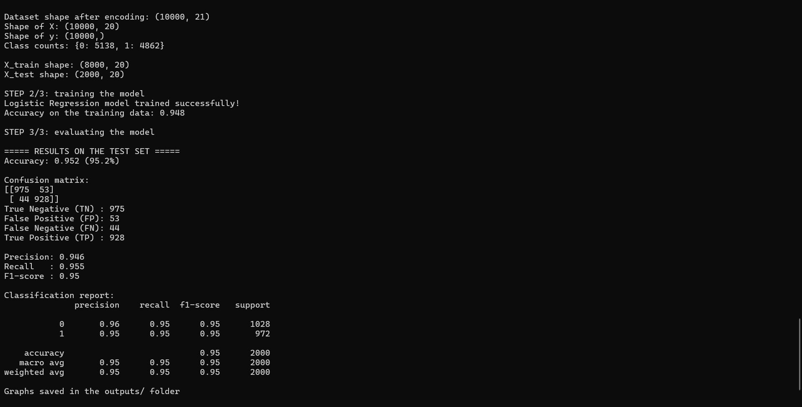
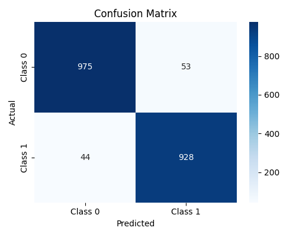
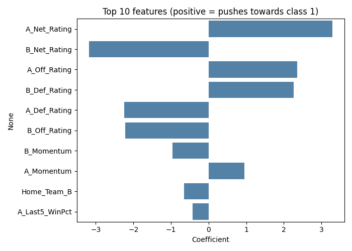

# AI101-Project (Group 41)

# Basketball Match Winner Predictor

Predicts which basketball team wins a match using logistic regression (pandas, matplotlib, scikit-learn).

`AI101 Mini-Project` · `Team 41` · `Python 3.10+`

## Team and roles

| Member | Entry no. | GitHub handle | Role | Code file(s) they wrote |
|---|---|---|---|---|
| Mayur Ukey | 2026MCB1579 | Mayur-Ukey-358 | Documentation lead | `src/data_prep.py`, `README.md` |
| Rushabh Pethad | 2026EEB1403 | rushabh-iitrp | Execution lead | `src/train_model.py`, `src/main.py`, `requirements.txt` |
| Pratyaksh Soni | 2026ESB1488 | pratyaksh-esb | PPT lead | `src/evaluate.py` |
| Abhijith Uttaravelli | 2026AIB1089 | abhijith-aide | Video lead | `src/predict.py` |

## Problem and data

- **Goal:** predict whether a team wins a match (win / lose), given the match and team statistics.
- **Dataset:** Basketball Tournament Dataset (Kaggle, a simulated dataset), https://www.kaggle.com/datasets/sharmajicoder/basketball-tournament-dataset
- **Size:** [10000 rows, 22 columns]
- **Target column:** Winner
- **Model:** Logistic regression (binary classification)

> **Note on the data:** The dataset is a simulated basketball tournament dataset from Kaggle, not real match records. The results therefore show how the method works, not how well it would predict real NBA or tournament games.

## Project structure

```
basketball-win-predictor/
├── data/
│   └── Basketball Tournament Dataset.csv      # dataset
├── src/
│   ├── data_prep.py                 # load, clean, split the data
│   ├── train_model.py               # train the logistic regression model
│   ├── evaluate.py                  # metrics and plots
│   ├── predict.py                   # predict the winner of one match (demo)
│   └── main.py                      # runs the whole pipeline
├── outputs/                         # plots and results are saved here
├── docs/
│   ├── Team41_slides.pdf            # 5 slides
│   └── expected_output.png          # screenshot of a successful run
├── requirements.txt
├── .gitignore
└── README.md
```

## Setup

Tested on Python 3.14.6 (Windows).

```bash
git clone https://github.com/Mayur-Ukey-358/AI101-Project.git
cd AI101-Project
python -m venv venv
venv\Scripts\activate
pip install -r requirements.txt   /   python -m pip install -r requirements.txt  (If Blocked by System)
```

## How to run

1. Run: `python src/main.py`
2. The script prints the model accuracy and other metrics, and saves plots in `outputs/`.
3. To predict one match: `python src/predict.py`
4. Expected runtime: under 45 seconds.

## Expected output



## Results

| Metric (test set, 2,000 matches) | Value |
|---|---|
| Accuracy | 0.952 (95.2%) |
| Precision | 0.946 |
| Recall | 0.955 |
| F1-score | 0.950 |

Confusion matrix: TN = 975, FP = 53, FN = 44, TP = 928.

On the 2,000 test matches, the logistic regression model predicts the winner correctly 95.2% of the time. Always guessing the more common outcome would be right only 51.4% of the time, so the model has learned useful patterns. Training accuracy (94.8%) is close to test accuracy (95.2%), so the model is not overfitting, and its errors are balanced between the two classes.




Note: the dataset is simulated, so these results show that the method works, not how well it would predict real basketball matches.

## Links

- Slides (5): [docs/Team41_Slides.pdf](docs/Team41_Slides.pdf)
- Video (05:26): https://drive.google.com/file/d/1hluHhQezcU_4uTmkDUjRROvN31PDVSc7/view?usp=drivesdk

## AI-use disclosure

Claude (Anthropic) helped structure and debug the code and draft the README and slides. We ran and 
tested every file ourselves, and each member can explain their part. All results come from running our code on the Kaggle 
dataset.
